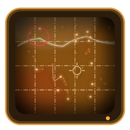
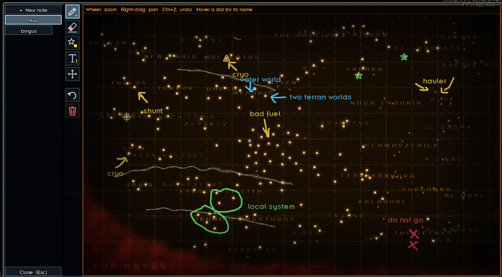
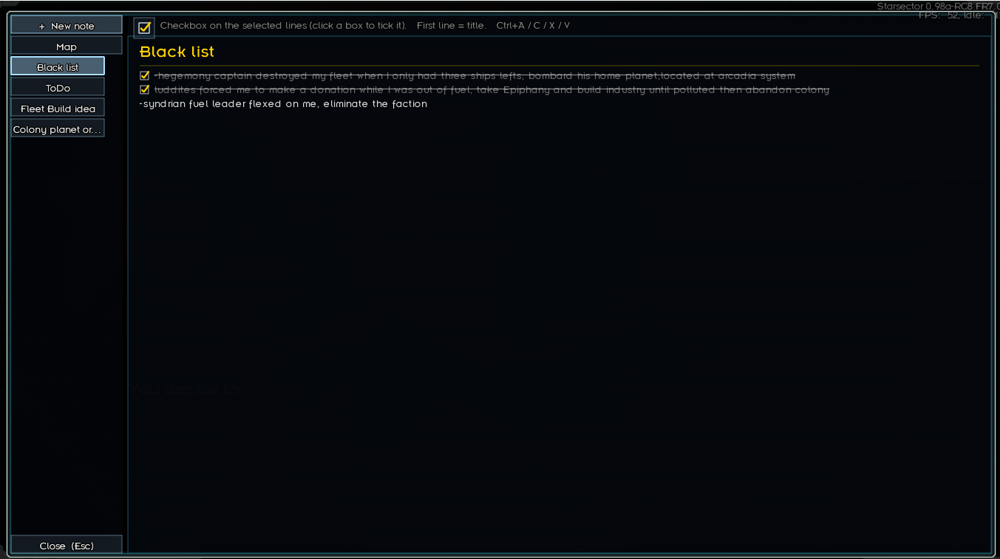
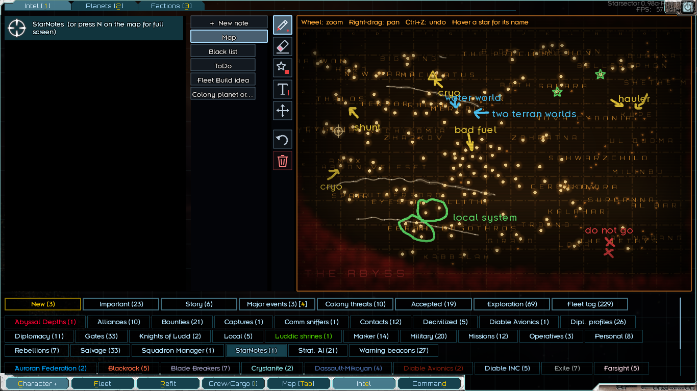

<p align="center"></p>

# StarNotes

**A notebook and a drawable star map for your Starsector campaign, on an amber CRT screen.**

StarNotes gives you a place to plan: mark where the good salvage was, circle the system you need to come back to, sketch a route along the slipstreams, and keep checklists for your colonies, all saved inside your campaign.

## Features

### The map
- Your own copy of the sector on an old amber monitor: scanlines, a slow rolling band, curved-tube vignette, flicker and phosphor glow.
- Dash-dot grid in the same cells as the game's map, with column letters and row numbers.
- Constellation names when zoomed out, star system names as you zoom in. Visited systems glow brighter.
- **Live slipstreams**, read from the game each time you open the map, so they follow the half-yearly reshuffle. Only the parts your normal map shows are drawn.
- **The Abyss** drawn as a slowly breathing red cloud. When your fleet is inside it, the screen glitches every few seconds.
- Your fleet's position as a pulsing crosshair.
- Smooth zoom toward the cursor (mouse wheel) and panning (right-drag).



### Drawing tools
Icon toolbar on the left; click a tool again to open its options.

| Tool | What it does |
|---|---|
| Pen | Freehand lines in 5 colors, 3 thicknesses, solid / dashed / dash-dot |
| Eraser | Drag over a line, symbol or text to remove it, like the Windows Snipping Tool |
| Symbols | Place X, square, triangle, diamond, star and ring markers; drag to move them |
| Text | Click the map and type; 4 sizes, 5 colors; click text to edit or drag it |
| Move | Drag symbols and text; drag empty space to pan |
| Undo | Undo the last change (also Ctrl+Z) |
| Clear | Erase the whole drawing (asks to confirm; Undo can bring it back) |

### Notes
- Add as many note tabs as fit with **+ New note**. The first line you type is the title, shown in a larger font and used as the tab's name.
- A real text editor: click to place the cursor, select by dragging, Shift+arrows, double-click or Ctrl+A; copy, cut and paste with the Windows clipboard; held keys repeat; word wrap and scrolling.
- **Checklists:** the checkbox button puts a box in front of the selected lines. Click a box to tick it and the line is dimmed and struck through.
- Hover a note tab and click the X to delete it (with confirmation).



## Opening StarNotes
- Press **N** on the campaign map for the full-screen window (Esc or Close to leave). The game pauses while it's open.
- Or open the **Intel** screen and pick the **StarNotes** entry / tag.

The key can be changed in `data/config/settings.json` (`starnotes_hotkey`, an LWJGL key code: 49 = N, 37 = K, 38 = L...).



## Requirements

| | |
|---|---|
| Starsector | **0.98a** |
| [LazyLib](https://github.com/LazyWizard/lazylib) | **Required**: draws the map and note text. Made with LazyLib 3.0.0. |

Optional:
- **Version Checker** / **TriOS**: StarNotes ships a `StarNotes.version` file pointing at this repository, so update checks and the changelog viewer work. TriOS also picks up the mod's icon.

## Installation
1. Install and enable **LazyLib**.
2. Download `StarNotes.zip` from the [latest release](https://github.com/toasty-wheeler/starsector-starnotes/releases/latest).
3. Unzip it into `Starsector/mods/` so that you have `mods/StarNotes/mod_info.json`.
4. Enable StarNotes in the launcher (or TriOS) and load a campaign.

Updating: replace the `mods/StarNotes` folder. Your drawings and notes live in your save, not in the mod folder.

## Save compatibility
- **Safe to add** to an existing campaign.
- **Not safe to remove** from a campaign that has been saved with it: the save contains the StarNotes Intel entry. Back up your saves before removing it.
- Your drawings and notes are stored as plain text in the save's persistent data.

## Building from source
The sources are in `src/starnotes`. Compile against the game's jars and LazyLib, targeting the Java version bundled with 0.98a (Java 17):

```
javac --release 17 -d out -cp "<Starsector>/starsector-core/starfarer.api.jar;<Starsector>/starsector-core/lwjgl.jar;<Starsector>/starsector-core/lwjgl_util.jar;<Starsector>/starsector-core/log4j-1.2.9.jar;<Starsector>/mods/LazyLib/jars/LazyLib.jar" src/starnotes/*.java
jar cf jars/StarNotes.jar -C out starnotes
```

## Changelog
See [changelog.txt](changelog.txt).
